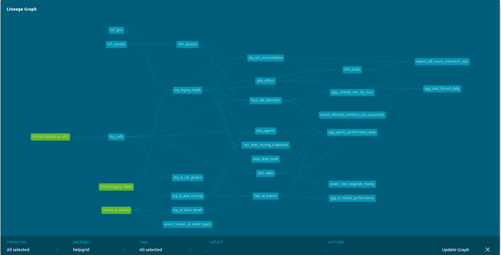
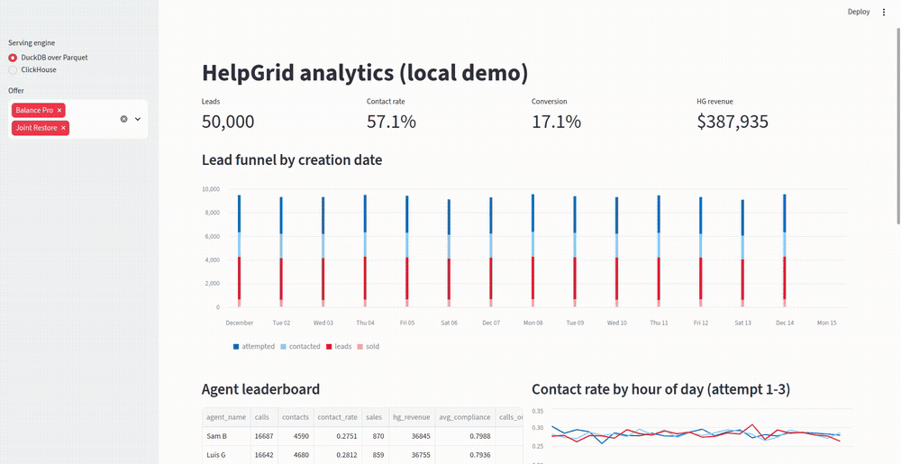

# HelpGrid Medallion Lakehouse (local demo)

A runnable, local version analytics pipeline built to address HelpGrid analytics challenge. It mirrors the target
**Microsoft Fabric → OneLake → Lakehouse → ClickHouse → Power BI** architecture using local tools.

It takes the messy legacy lead extract and the heterogeneous AI event log through a **medallion**
(bronze → silver → gold) pipeline, models them as a dimensional schema, serves them from ClickHouse,
and visualises them in a dashboard. Everything is tested end to end.

```
 landing files            BRONZE               SILVER                  GOLD                   SERVING
┌──────────────┐    ┌───────────────┐    ┌────────────────┐    ┌──────────────────┐    ┌──────────────┐
│ legacy CSV   │    │ raw, typeless │    │ typed, deduped │    │ star schema +    │    │ ClickHouse   │
│ AI events    │───▶│ Parquet       │───▶│ Parquet        │───▶│ marts (DuckDB)   │───▶│ MergeTree    │──▶ dashboard
│ call log     │    │ + lineage     │    │ business rules │    │ → Parquet export │    │ (or DuckDB)  │    (Power BI)
└──────────────┘    └───────────────┘    └────────────────┘    └──────────────────┘    └──────────────┘
   generate_data.py    ingest_bronze.py          dbt (silver/)         dbt (gold/, marts/)    load_clickhouse.py
                                                                       + snapshots, tests
```

| Local tool | Role | Fabric equivalent |
|---|---|---|
| Parquet folders (`data/bronze,silver,gold`) | Lake storage | OneLake / Lakehouse Files + Delta tables |
| **DuckDB** | Compute engine (vectorised, parallel, columnar) | Fabric Spark / SQL analytics endpoint |
| **dbt** (`dbt-duckdb`) | Transformations, tests, lineage, snapshots | `dbt-fabricspark` / `dbt-fabric` |
| `scripts/run_pipeline.py` | Orchestration + run observability | Data Factory pipeline + Monitoring Hub |
| **ClickHouse** (Docker) | Low-latency serving layer | ClickHouse (unchanged) |
| **Streamlit** dashboard | BI | Power BI |

---

## Data lineage graph



## BI serving layer with Streamlit



## 1. Quick start

**Prerequisites:** Python 3.10+ and `make` (macOS/Linux/WSL). Docker is optional (ClickHouse only).

```bash
make install      # creates .venv and installs dependencies
make data         # generates synthetic landing data (50k leads, ~160k calls, ~65k AI events)
make pipeline     # bronze -> silver -> gold, runs 66 dbt models/tests, exports gold Parquet  (~11s)
make dashboard    # http://localhost:8501  (reads gold Parquet through DuckDB)
```

Optional extras:

```bash
make incremental          # lands a 2nd batch (new leads + status changes) and runs incrementally
make test                 # 7 end-to-end tests in an isolated temp lakehouse (~15s)
make report               # run history, slowest dbt models, regression flags

make clickhouse-up        # start ClickHouse in Docker
make load-clickhouse      # load gold into ClickHouse (incremental watermark for big facts)
make dashboard            # choose "ClickHouse" in the sidebar

make dbt-docs             # lineage graph on http://localhost:8080
make data LEADS=400000    # bigger run (use the same LEADS for `make incremental`, which adds LEADS/10 new leads)
make clean                # wipe generated layers but keep landing files
```

No `make` (e.g. native Windows)? Run the same steps by hand:

```bash
python -m venv .venv && .venv/bin/pip install -r requirements.txt    
.venv/bin/python scripts/generate_data.py --leads 50000
cd scripts && ../.venv/bin/python run_pipeline.py
```

---

## 2. What each layer does

### Landing (`data/landing/<batch>/`)
Three files per batch. Two mirror the assessment inputs; **the third is synthetic**:

| File | Source | Note |
|---|---|---|
| `HG_Legacy_Lead_Analytics_Synthetic.csv` | Assessment | Same 30 columns, messy on purpose |
| `ai_interactions_events.json` | Assessment | `katie_email`, `alas_routing_decision`, `victoria_call_grade` |
| `telephony_calls.csv` | **Added by this project** | Per-dial call log. The legacy file only has aggregates, so call-level modelling needs a call-level source. In production this comes from your telephony/dialer system. |

Injected defects (each one is detected or fixed downstream): 3 mixed timestamp formats, float-formatted IDs (`301.0`),
blank agent names with populated agent IDs, duplicate lead rows, `Ontario` vs `ON`, country/state mismatches,
sale amount without sale flag, legacy call counts that disagree with the call log (~2%), AI events with null
`lead_id`/`agent_id`, and call grades pointing at calls that don't exist.

### Bronze (`scripts/ingest_bronze.py`)
Append-only Parquet partitioned by batch. **No cleaning, no typing**: CSV columns stay `VARCHAR`; each AI event keeps its full original JSON in
`payload`. Rows carry `_batch_id`, `_source_file`, `_ingested_at`. Idempotent (re-running a batch is a no-op).
Because the payload is schema-on-read, a *fourth* AI event type lands safely; a dbt test then fails loudly until someone models it.

### Silver (`dbt_project/models/silver/`, materialised as external Parquet)
| Model | Grain | What it does |
|---|---|---|
| `stg_legacy_leads` | 1 / lead | Types, 4 timestamp formats, blank→NULL, PII hashing, dedup (latest extract wins), **re-derives** the business rules (see §4) |
| `stg_calls` | 1 / dial | Typing, dedup, `attempt_number` over full history |
| `stg_ai_katie_email`, `stg_ai_alas_routing`, `stg_ai_call_grades` | 1 / event | Per-type typed schemas parsed from the JSON payload; `link_quality` |

### Gold (`models/gold/`, `models/marts/`)
| Table | Grain | Notes |
|---|---|---|
| `dim_leads`, `dim_offers`, `dim_agents`, `dim_queues` | entity | Hashed surrogate keys for offers/queues; `agent_id` is canonical (names are display-only) |
| `fact_call_attempts` | 1 / dial | **Incremental** (`delete+insert` on `call_id`) |
| `fact_sales` | 1 / lead with any revenue | `revenue_type` = `sale` / `disposition_fee` / `amount_without_sale` |
| `fact_lead_routing_snapshots` | 1 / observed routing state | Legacy extract + AI routing decisions that carry a `lead_id` |
| `fact_ai_events` | 1 / AI event | **Incremental**; `link_quality`, `call_linked` |
| `snapshots.snap_lead_state` | SCD2 | Status / inbox / queue / agent history |
| `agg_lead_funnel_daily`, `agg_agent_performance_daily`, `agg_ai_model_performance`, `agg_contact_rate_by_hour` | marts | Pre-aggregated for BI |
| `dq_call_reconciliation` | 1 / disagreeing lead | Proves legacy aggregates vs call log |

Full ER diagram: [`docs/data_model.md`](docs/data_model.md).

---

## 3. Things worth trying (they demonstrate the design)

1. **Incremental processing.** `make incremental`, then compare `make report`: gold facts only process the new batch,
   and `fact_call_attempts` grows by exactly the new calls with no duplicates (also asserted by `make test`).
2. **SCD2 history.** Batch 2 re-emits 5% of existing leads with a new status.
   ```sql
   select lead_id, status, dbt_valid_from, dbt_valid_to from snapshots.snap_lead_state
   where lead_id in (select lead_id from snapshots.snap_lead_state where dbt_valid_to is not null limit 1)
   order by dbt_valid_from;
   ```
   Query with `duckdb data/lakehouse.duckdb` (or any DuckDB client).
3. **Data quality as code.** `select * from gold.dq_call_reconciliation limit 20;` lists leads whose legacy
   `Calls Attempted` disagrees with the call log. Lower `call_count_max_mismatch_rate` in `dbt_project.yml` to make the build fail.
4. **Nothing is silently dropped.** `select link_quality, count(*) from gold.fact_ai_events group by 1;`: events with null lead/agent are kept and labelled.
5. **Observability.** `make report` shows each run's duration vs the median of previous runs and its slowest dbt models
   (this is the tooling you'd want for the "pipeline went from 9 to 45 minutes" scenario).

---

## 4. How the legacy business logic was handled

| Embedded in the legacy file | Treatment |
|---|---|
| Call scheduling windows (`Proper Time…`, `Lead Calls Schedule…`) | Kept as `call_window_*` + `schedule_*`; `has_schedule_override` flags leads whose schedule differs from the proper window. `fact_call_attempts.is_within_call_window` is computed **per dial** using the override when present |
| `DuplicateLead` | Source flag kept (`is_duplicate_source_flag`) **plus** real dedup evidence (`is_repeated_in_source`). Nothing is deleted on the flag's say-so |
| `Mismatch` | **Re-derived** from state/country reference data (`ref_geo` seed). `mismatch_flag_disagrees` shows where the legacy flag was wrong |
| `Could Call When Created` | Re-derived from creation time vs the call window |
| `Calls Attempted / Contacted` | Replaced by call-level facts; reconciled in `dq_call_reconciliation` |
| `ALAS Queue`, `Lead Position` | Treated as point-in-time state → `fact_lead_routing_snapshots`, with queue names decoded via `dim_queues` |
| `Sale Amount` ≠ 0 with sale = 0; `HG Revenue` ≠ 0 with no sale | Explicit `revenue_type` instead of hiding the inconsistency |

---

## 5. Performance choices (and measured results)

* **Columnar everywhere:** Parquet + ZSTD for bronze/silver/gold (bronze 41 MB vs 301 MB raw landing at 400k leads).
* **Vectorised, multi-threaded engine:** DuckDB with dbt `threads: 4`.
* **Incremental gold facts** on an `_ingested_at` watermark instead of full rebuilds.
* **Sorted gold Parquet** (`export_gold.py`) → tight row-group statistics so readers can skip data.
* **ClickHouse design:** `ORDER BY` matches common filters, monthly `PARTITION BY` on big facts, `LowCardinality(String)`,
  `ReplacingMergeTree` for idempotent loads, and loading via ClickHouse's own `file()` Parquet reader (no row transfer through Python).
* **Pre-aggregated marts** so dashboards never scan fact tables.

Measured on the (small) sandbox used to build this project, 4 threads, 4 GB memory limit, full pipeline including 66 dbt nodes/tests:

| Scale | Leads / calls / AI events | Pipeline time |
|---|---|---|
| default | 50k / 164k / 67k | ~11 s |
| 8× | 406k / 1.3M / 541k | ~34 s |

Treat these as indicative, not a benchmark: your hardware will differ. Time grew ~3× for 8× data. The slowest stage at 8× was silver
(`stg_calls`, `stg_legacy_leads`), because silver is a **full rewrite each run**; see the limitations below.

---

## 6. Project layout

```
helpgrid-medallion/
├── Makefile  requirements.txt  docker-compose.yml  .env.example
├── scripts/
│   ├── generate_data.py     synthetic landing data with injected defects
│   ├── ingest_bronze.py     raw -> bronze Parquet
│   ├── run_pipeline.py      orchestration + run log + regression flag
│   ├── export_gold.py       gold tables -> sorted Parquet
│   └── load_clickhouse.py   Parquet -> ClickHouse (incremental watermark)
├── dbt_project/
│   ├── models/silver|gold|marts   (+ schema tests)
│   ├── snapshots/           SCD2 of lead state
│   ├── seeds/               ref_geo (states/provinces), ref_queues
│   ├── macros/              parse_ts, hash_pii, clean_str, link_quality
│   └── tests/               singular tests (reconciliation, event types, sequencing, money)
├── clickhouse/init.sql      serving-layer DDL
├── dashboard/app.py         Streamlit "Power BI stand-in"
├── tests/                   pytest end-to-end suite
└── docs/                    architecture, data model, Fabric porting guide
```

---

## 7. Honest limitations

* **Silver is not incremental.** It is rewritten from all bronze each run (cheap at this scale, and it keeps dedup/`attempt_number` simple and correct).
  At 10×+ you would make silver incremental (merge on `lead_id`/`call_id`, watermark on `_ingested_at`) and partition by date. See `docs/architecture.md`.
* **SQL is DuckDB dialect** (`try_strptime`, `QUALIFY`, `arg_max`, `mode`, `quantile_cont`). Porting to Fabric needs mechanical rewrites; see `docs/fabric_porting.md`.
* **Queue meanings and `HG Revenue` semantics are assumptions.** `ref_queues` is explicitly marked PLACEHOLDER; `disposition_fee` is my interpretation of revenue with no sale. Confirm both with the business.
* **ClickHouse marts are truncate-and-reload**, which leaves a brief empty window during load. A production loader would load into a shadow table and `EXCHANGE TABLES`.
* **Unlinked routing events stay unlinked.** ALAS decisions without a `lead_id` are not guessed onto leads via time-window joins; that would manufacture relationships.
* **The call log is synthetic.** Results like contact-rate-by-hour reflect the generator, not real behaviour.
* **Verification scope:** dbt, Parquet export, the dashboard, and all tests were executed. The ClickHouse DDL and every generated `INSERT` were executed against an *embedded* ClickHouse engine (`chdb`)
  and row counts matched gold, but the **Docker Compose service itself was not started** in the build environment. If `make clickhouse-up` misbehaves, check the volume mount for `user_files/gold`.

---

## 8. Troubleshooting

| Symptom | Fix |
|---|---|
| `dbt: command not found` | Use `make` targets (they use `.venv`), or `source .venv/bin/activate` |
| `Cannot open file .../silver/...parquet` | Run via `make pipeline` / `run_pipeline.py` (it creates the layer folders first) |
| Dashboard says "Could not read data" | Run `make pipeline` first |
| ClickHouse `file()` permission/path error | Ensure `./data/gold` exists before `make clickhouse-up`, then restart the container |
| Out-of-memory at large scale | `HG_MEMORY_LIMIT=8GB make pipeline` |
| Start over | `make clean && make pipeline` |
