# Architecture notes

## Flow

```mermaid
flowchart LR
  L[Landing files<br/>CSV / JSON] -->|ingest_bronze.py| B[(Bronze<br/>raw Parquet + lineage)]
  B -->|dbt silver| S[(Silver<br/>typed, deduped Parquet)]
  S -->|dbt gold + marts| G[(Gold<br/>DuckDB tables)]
  G -->|export_gold.py| GP[(Gold Parquet<br/>sorted, ZSTD)]
  GP -->|ClickHouse file&#40;&#41;| C[(ClickHouse<br/>MergeTree)]
  C --> D[Dashboard / Power BI]
  GP --> D
```

## Layer contracts
| Layer | Mutability | Typing | Rule |
|---|---|---|---|
| Bronze | append-only | none (all VARCHAR / raw JSON) | Never fail on bad data; keep lineage |
| Silver | rebuilt | strict | One row per business key; flags, not deletions |
| Gold | incremental facts, rebuilt dims/marts | strict | Dimensional model, tested keys and relationships |
| Serving | reload / watermark | ClickHouse types | Optimised for filter + aggregate latency |

## Key decisions
1. **Bronze keeps JSON payloads whole.** New AI event types never break ingestion; a singular dbt test forces someone to model them.
2. **Re-derive, don't trust, embedded flags.** Mismatch, call-ability and duplicate logic are recomputed and compared with the legacy value, so disagreement is measurable.
3. **Null relationships are data.** AI events with null `lead_id`/`agent_id` are kept with `link_quality`; call grades are linked through `call_id`; unresolvable links are never guessed.
4. **Idempotency everywhere.** Bronze skips ingested batches, incremental facts `delete+insert` on the key, ClickHouse uses `ReplacingMergeTree`.
5. **PII leaves the building as a salted hash.** Raw phone never appears in silver or gold. Set `HG_PII_SALT` in real environments.

## Scaling to 10× and beyond
| Area | Change |
|---|---|
| Silver | Make incremental (merge on key, `_ingested_at` watermark); partition Parquet/Delta by date |
| `fact_call_attempts` | Partition by `call_date`; Z-order / sort by `lead_id`; keep `attempt_number` via a bounded look-back for late data |
| `fact_ai_events` | Split by `event_type` for BI-specific tables; keep the unified table as the audit record |
| `fact_lead_routing_snapshots` | Partition by week; roll snapshots older than N days to a cold tier |
| ClickHouse | Load marts via shadow table + `EXCHANGE TABLES`; add projections or materialised views for the hottest dashboard queries; TTL for retention |
| Orchestration | Run bronze/silver per source in parallel; gate gold on dbt tests; alert on `vs_median` regression (see `make report`) |
| Capacity (Fabric) | Schedule heavy jobs away from BI refresh windows; monitor CU smoothing in the Capacity Metrics app |
