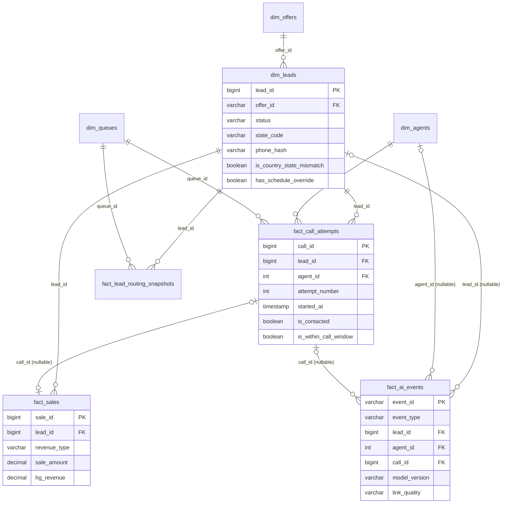

# Data model

Differences from the earlier design discussion, deliberately made while building it:

* `dim_leads` holds **current** state; history lives in `snapshots.snap_lead_state` (dbt snapshot) rather than `valid_from/valid_to` columns.
* `fact_sales` holds every lead with a revenue signal and labels it with `revenue_type`, instead of pretending all rows are sales.
* `fact_ai_events` adds `call_linked` and resolves `lead_id`/`agent_id` for call grades through the call log.
* `fact_call_attempts` requires a call-level source; the synthetic `telephony_calls.csv` stands in for it.
